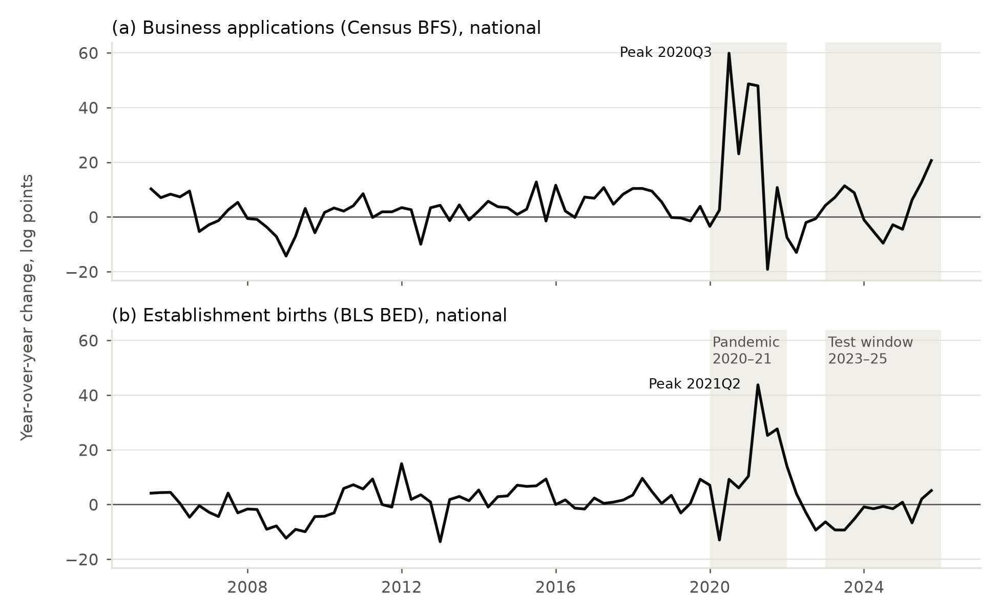
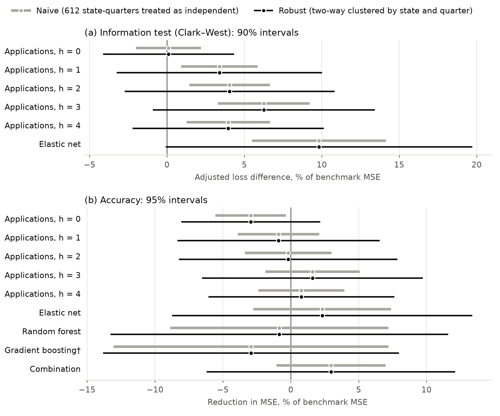
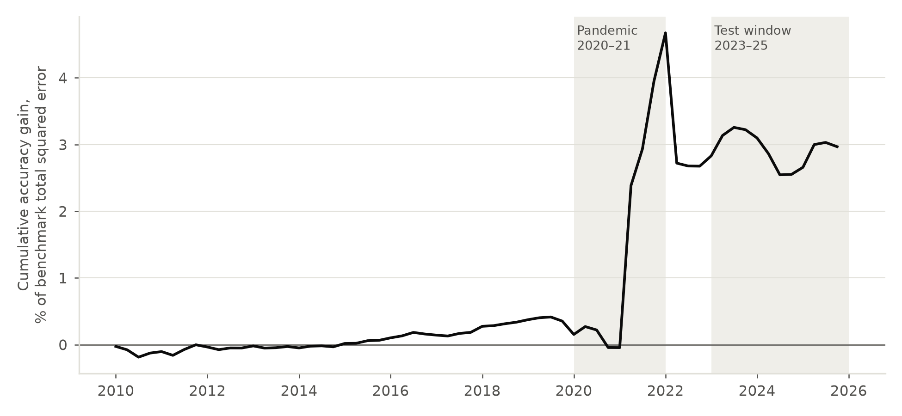
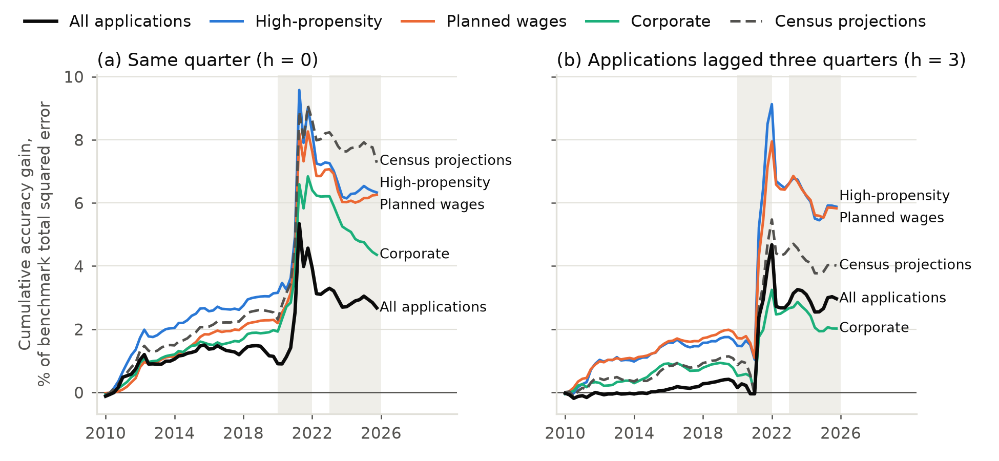
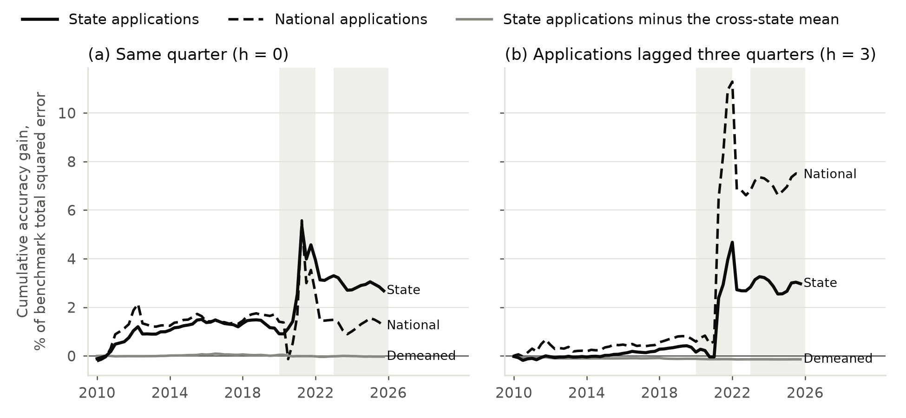
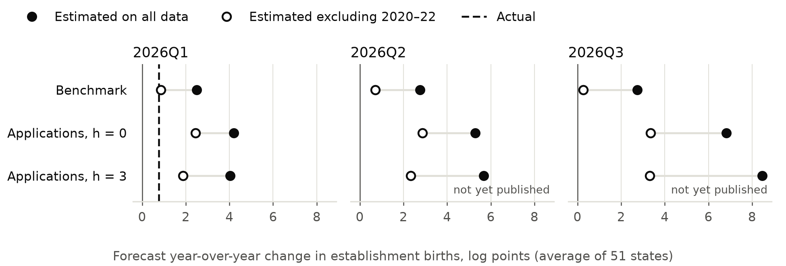
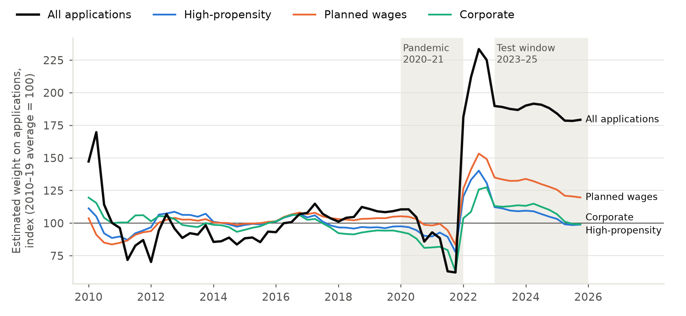
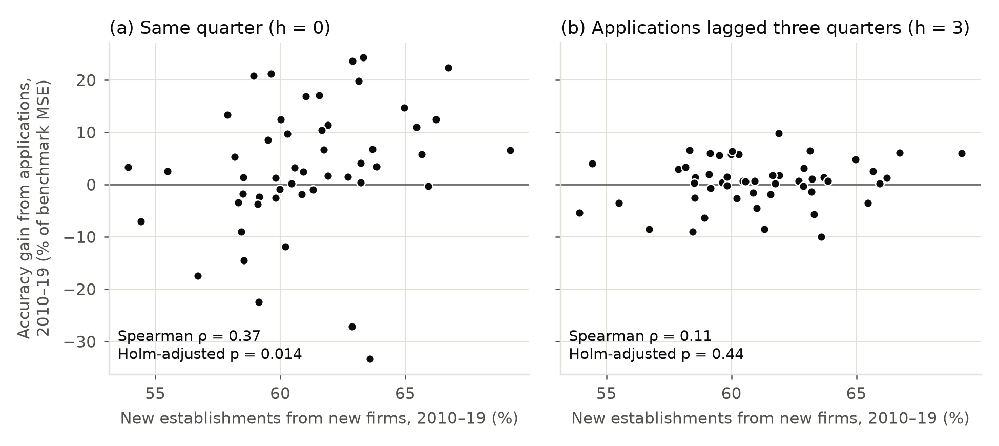

# Manuscript figures

*Updated 2026-11-09 for [draft_v2.md](../draft_v2.md). Built by `src/analysis/make_paper_figures.py`, which is part of `replication/run_all.py`. The captions below are copied from the draft.*

All figures are drawn from committed output tables, the committed analysis panel, or the frozen live-forecast file. Nothing is re-estimated and no new test is run. Each figure is saved as PNG (300 dpi, for review) and as PDF (vector, for submission), sized for a 6.5-inch text width.

**Color.** All applications and establishment births are drawn in black, and color is used only to distinguish the three narrower application series (Figures 4 and A1). Census's projected business formations are a dashed gray line, and Figure 5 uses black and gray line styles only. Every line is also labeled directly, so the figures remain legible in grayscale print. The series colors were checked for separation under common forms of color-vision deficiency.

**Changes from draft v1.**

- **Figure 4** adds Census's projected business formations.
- **Figure 5** is new: state versus national applications.
- **The weight paths and the new-firm-share scatter** (draft v1's Figures 5 and 6) moved to the appendix as Figures A1 and A2.
- **The live-forecast figure** (draft v1's Figure 7) is now Figure 6.

---

## Figure 1 (Section 3)

**Figure 1.** National year-over-year change in business applications (a) and establishment births (b), 2005Q3–2025Q4, in log points (100 × the log change from the same quarter a year earlier), not seasonally adjusted. Shaded: the pandemic (2020–21) and the test window (2023–25). *Sources: Census Bureau, Business Formation Statistics; BLS, Business Employment Dynamics.*

## Figure 2 (Section 6.2)

**Figure 2.** Test-window comparisons with the benchmark, 2023Q1–2025Q4 (612 state-quarters). Gray intervals treat every state-quarter as independent; black intervals are two-way clustered by state and quarter.

- **Panel (a):** Clark–West adjusted loss difference with 90% intervals, so that a black interval lying wholly above zero corresponds to rejection at the 5% level in the one-sided information test. The tree-based models (for which the adjustment is not meaningful; Section 6.6) and the combination are omitted, as in Appendix Table A1.
- **Panel (b):** reduction in mean squared error with 95% intervals; positive values favor the model.

†Robust interval from the wild cluster bootstrap by quarter, because it is materially wider than the two-way clustered interval for this model. *Source: outputs/tables/phase5_comparisons.csv.*

## Figure 3 (Section 6.3)

**Figure 3.** Cumulative accuracy gain from adding applications at a three-quarter lead, 2010Q1–2025Q4. Each quarter adds the reduction in squared error relative to the benchmark, averaged across states. The running total is expressed as a percentage of the benchmark's total squared error over the whole period, so the final value (3.0%) is the accuracy gain over 2010–2025 as a whole. A rising line means the model with applications beat the benchmark that quarter. Shaded: the pandemic (2020–21) and the test window (2023–25); the unshaded year between them is 2022. 2010–2022 is pseudo-out-of-sample. *Source: outputs/tables/rq2_predictions.csv.*

## Figure 4 (Section 6.4)

**Figure 4.** Cumulative accuracy gain by application series, and for Census's projected business formations (dashed; not pre-specified), constructed as in Figure 3, at the same-quarter (a) and three-quarter (b) leads. Shaded: the pandemic (2020–21) and the test window (2023–25). *Sources: outputs/tables/rq2_predictions.csv, a5_E_pbf_predictions.csv.*

## Figure 5 (Section 6.5)

**Figure 5.** Cumulative accuracy gain, constructed as in Figure 3, from adding state application growth (solid black), national application growth (dashed), or state application growth minus its cross-state average in the same quarter (gray), at the same-quarter (a) and three-quarter (b) leads. Not pre-specified. Shaded: the pandemic (2020–21) and the test window (2023–25). *Source: outputs/tables/a5_G1_predictions.csv.*

## Figure 6 (Section 8)

**Figure 6.** Pre-registered forecasts for 2026Q1–Q3 (first set), committed before BLS published any 2026 establishment-birth data. Each point is the average forecast across the 51 states, with equal weights as in the evaluation. Filled points: models estimated on all data. Hollow points: models estimated excluding 2020–2022. The dashed line marks the actual average change in 2026Q1, from the BLS release of 28 October 2026; 2026Q2 and 2026Q3 had not yet been published. The pre-registered test compares state-level squared errors, not these averages. *Sources: outputs/live_forecasts/live_forecasts_2026Q1-Q3.csv, actuals_2026-11-04.csv.*

## Figure A1 (Appendix A)

**Figure A1.** Estimated weight on applications at a three-quarter lead, from each expanding-window re-estimation, by series. Each series is indexed to its own 2010–2019 average (= 100). Estimates are dated by forecast quarter; each uses data through three quarters earlier. The 2010 estimates rest on short samples. *Source: outputs/tables/rq2_coefficient_paths_h3.csv.*

## Figure A2 (Appendix B)

**Figure A2.** State accuracy gain from applications over 2010–2019, against the share of new establishments belonging to new firms (Business Dynamics Statistics, 2010–2019 average). One point per state (51). Holm adjustment is across the two leads. *Sources: outputs/tables/rq4_state_data.csv, rq4_correlations.csv.*

---

## Notes

1. **Overlap.** The line in Figure 3 also appears as the black line in Figures 4(b) and 5(b). Figure 3 is kept separate because it carries the main result of Section 6.3.
2. **Equal versus size weighting in Figure 6.** Summed to a national total, the forecasts are lower and closer together, because the models forecast lower growth for large states than for small ones. The figure uses equal weights to match the scoring.
3. **The forecasts from Census's projections** (the second pre-registered set) are not drawn in Figure 6. Their mean forecasts are in the project research log (entry of 2026-11-09).
4. **Not yet checked:** the *Journal of Forecasting*'s current figure requirements (file format, resolution, color charges).
