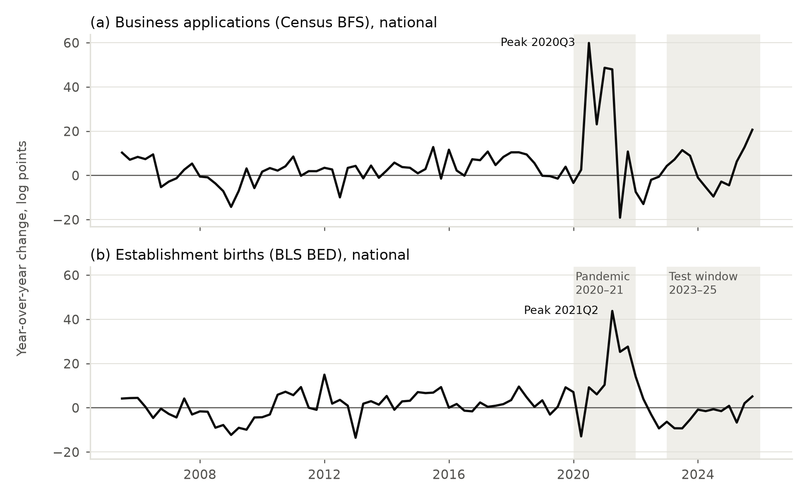
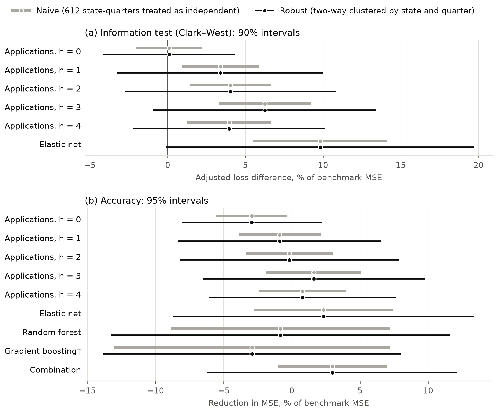
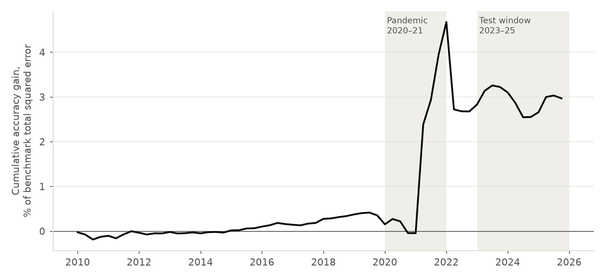
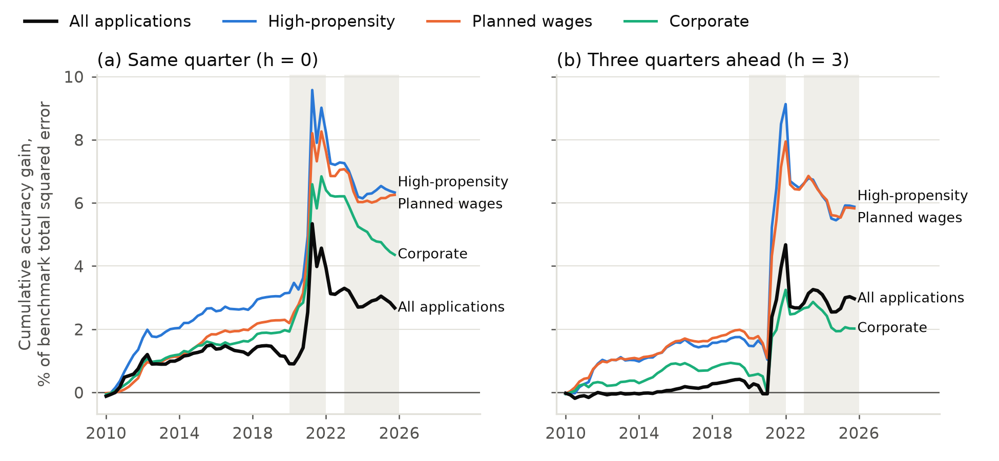
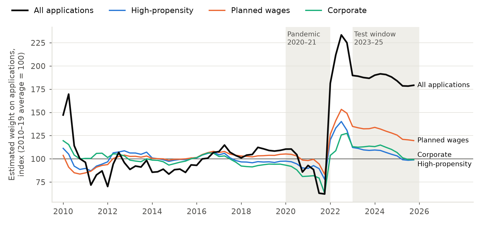
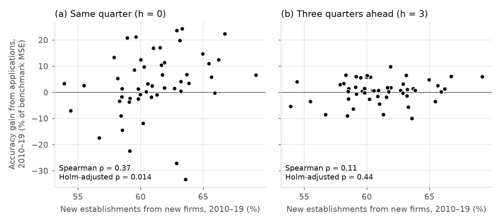
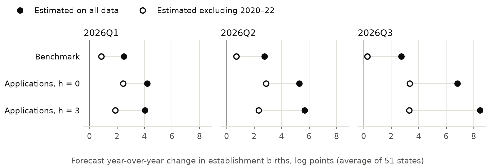

# Manuscript figures

*Updated 2026-10-15. Built by `src/analysis/make_paper_figures.py`, which is part of `replication/run_all.py`. All seven figures appear in [draft_v1.md](../draft_v1.md) in the placements the author approved; the captions below are copied from the draft.*

All figures are drawn from committed output tables, the committed analysis panel, or the frozen live-forecast file. Nothing is re-estimated and no new test is run. Each figure is saved as PNG (300 dpi, for review) and as PDF (vector, for submission), sized for a 6.5-inch text width.

**Color.** All applications and establishment births are drawn in black. Color is used only to distinguish the three narrower application series (Figures 4 and 5), and every colored line is also labeled directly, so the figures remain legible in grayscale print. The series colors were checked for separation under common forms of color-vision deficiency.

**Layout.** All seven figures are in the main text. The main text has Tables 1 (test window), 2 (by period) and 3 (robustness). The appendix has Tables A1 (information-test p-values, formerly Table 2) and A2 (accuracy by application series, formerly Table 4), whose content Figures 2 and 4 present graphically.

---

## Figure 1 (Section 3)

**Figure 1.** National year-over-year change in business applications (a) and establishment births (b), 2005Q3–2025Q4, in log points (100 × the log change from the same quarter a year earlier), not seasonally adjusted. Shaded: the pandemic (2020–21) and the test window (2023–25). *Sources: Census Bureau, Business Formation Statistics; BLS, Business Employment Dynamics.*

## Figure 2 (Section 6.2)

**Figure 2.** Test-window comparisons with the benchmark, 2023Q1–2025Q4 (612 state-quarters). Gray intervals treat every state-quarter as independent; black intervals are two-way clustered by state and quarter. Panel (a): Clark–West adjusted loss difference with 90% intervals, so that a black interval lying wholly above zero corresponds to rejection at the 5% level in the one-sided information test; the tree-based models are omitted because the adjustment is not meaningful for them (Section 6.3). Panel (b): reduction in mean squared error with 95% intervals; positive values favor the model. †Robust interval from the wild cluster bootstrap by quarter, because it is materially wider than the two-way clustered interval for this model. *Source: outputs/tables/phase5_comparisons.csv.*

## Figure 3 (Section 6.4)

**Figure 3.** Cumulative accuracy gain from adding applications at a three-quarter lead, 2010Q1–2025Q4. Each quarter adds the reduction in squared error relative to the benchmark, averaged across states. The running total is expressed as a percentage of the benchmark's total squared error over the whole period, so the final value (3.0%) is the accuracy gain over 2010–2025 as a whole. A rising line means the model with applications beat the benchmark that quarter. 2010–2022 is pseudo-out-of-sample. *Source: outputs/tables/rq2_predictions.csv.*

## Figure 4 (Section 6.5)

**Figure 4.** Cumulative accuracy gain by application series, constructed as in Figure 3, at the same-quarter (a) and three-quarter (b) leads. Shaded: the pandemic (2020–21) and the test window (2023–25). *Source: outputs/tables/rq2_predictions.csv.*

## Figure 5 (Section 6.5)

**Figure 5.** Estimated weight on applications at a three-quarter lead, from each expanding-window re-estimation, by series. Each series is indexed to its own 2010–2019 average (= 100). Estimates are dated by forecast quarter; each uses data through three quarters earlier. The 2010 estimates rest on short samples. *Source: outputs/tables/rq2_coefficient_paths_h3.csv.*

## Figure 6 (Section 6.6)

**Figure 6.** State accuracy gain from applications over 2010–2019, against the share of new establishments belonging to new firms (Business Dynamics Statistics, 2010–2019 average). One point per state (51). Holm adjustment is across the two leads. *Sources: outputs/tables/rq4_state_data.csv, rq4_correlations.csv.*

## Figure 7 (Section 8)

**Figure 7.** Pre-registered forecasts for 2026Q1–Q3, committed before BLS published any 2026 data. Each point is the average forecast across the 51 states, with equal weights as in the evaluation. Filled points: models estimated on all data. Hollow points: models estimated excluding 2020–2022. The pre-registered test compares state-level squared errors, not these averages. [Actual values to be added as each quarter is published.] *Source: outputs/live_forecasts/live_forecasts_2026Q1-Q3.csv.*

---

## Notes

1. **Overlap.** The line in Figure 3 also appears as the black line in Figure 4(b). The author kept Figure 3 as a separate figure because it carries the main result of Section 6.4.
2. **Equal versus size weighting in Figure 7.** Summed to a national total, the forecasts are lower and closer together, because the models forecast lower growth for large states than for small ones (all-data applications models, 1.6–7.1 log points; benchmark, 0.4–4.2 log points). The figure uses equal weights to match the scoring.
3. **Not yet checked:** the *Journal of Forecasting*'s current figure requirements (file format, resolution, color charges).
